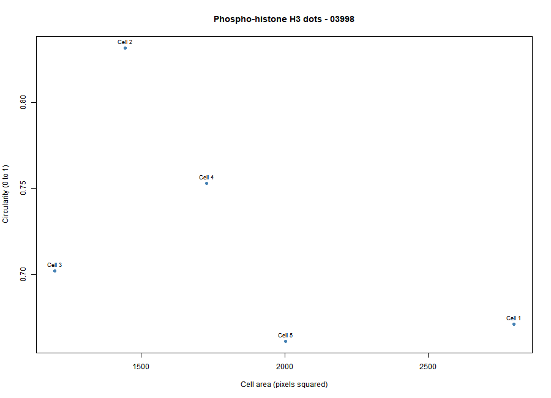
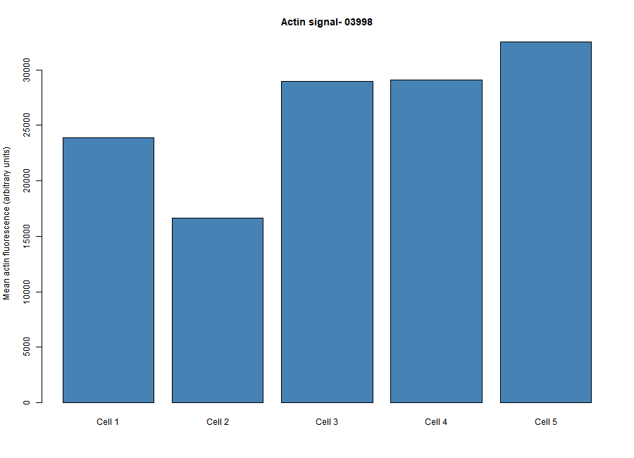

# Cytoskeleton and Cell Morphology

## 1. Student Information

- **Student ID:** 202400708
- **Chosen Phenotype:** Phospho-histone H3 dots
- **Image Field ID:** 03998
- **Actin Image:** `03998-actin.DIB`
- **DNA Image:** `03998-DNA.DIB`
- **pH3 Image:** `03998-pH3.DIB`

## 2. Introduction

This activity explores cell morphology and fluorescence staining patterns using the BBBC018v1 image dataset. Fiji/ImageJ was used to observe the fluorescence images and measure five selected cells. RStudio was then used to summarize the measurements, calculate descriptive statistics, and create plots to visualize cell area, circularity, and actin fluorescence intensity.

## 3. Software and Dataset

**Software used:**
- Fiji/ImageJ for image visualization and cell measurements.
- RStudio and R for data analysis and visualization.
- GitHub for organizing and presenting the project files.

**Dataset:** BBBC018v1 from the Broad Bioimage Benchmark Collection.

- [Dataset page](https://bbbc.broadinstitute.org/BBBC018)
- [Download dataset](https://data.broadinstitute.org/bbbc/BBBC018/BBBC018_v1_images.zip)

## 4. Procedure and Workflow

### Step 1. Downloading Fiji/ImageJ

Fiji/ImageJ was downloaded from the official website and prepared for image analysis. The application was launched to access the tools needed to open fluorescence images and measure cell morphology.

**Screenshot 1.** Downloading and preparing Fiji/ImageJ for image analysis.

### Step 2. Downloading and Extracting the BBBC018 Dataset

The BBBC018v1 image dataset was downloaded and extracted. The files corresponding to image field 03998 were located for the activity.

**Screenshot 2.** Extracted BBBC018 dataset files.

### Step 3. Opening the Selected Image in Fiji

The selected actin image, `03998-actin.DIB`, was opened in Fiji for cell morphology measurements. The DNA and pH3 images were also used as visual references. The Bio-Formats Importer was used to open the image files.

**Screenshot 3.** Opening the selected fluorescence image in Fiji.

### Step 4. Selecting, Tracing, and Measuring Five Cells

Five identifiable cells were selected from the actin image and outlined using Fiji's selection tools. The selected regions were managed using the ROI Manager. Measurements included area, mean fluorescence intensity, circularity, and aspect ratio. The results were saved as `data/fiji_results.csv`.

**Screenshot 4.** Selecting cells, managing ROIs, and recording measurements in Fiji.

### Step 5. Analyzing the Measurements in RStudio

The Fiji measurement data were imported into RStudio for analysis. An R script was used to calculate summary statistics and generate visualizations. The summary results were saved as `results/cell_summary.csv`.

**Screenshot 5.** Analyzing cell measurements using RStudio.

## 5. Results and Data Analysis

Five cells from image field 03998 were measured using Fiji/ImageJ. The measurements were analyzed in RStudio to obtain the mean values and compare the morphology and actin fluorescence intensity of the selected cells.

### Summary of Measurements

| Measurement | Mean Value |
|---|---:|
| Cell area | 1834.2 pixels² |
| Circularity | 0.7238 |
| Aspect ratio | 1.2294 |
| Mean actin fluorescence intensity | 26235.14 arbitrary units |

### Figure 1. Cell Area Versus Circularity

**Interpretation:** The plot shows the relationship between the measured area and circularity of the five cells. Cell 1 had the largest area at 2799 pixels², while Cell 3 had the smallest at 1198 pixels². Cell 2 had the highest circularity (0.832), while Cell 5 had the lowest (0.661). These differences indicate variation in cell size and shape.

### Figure 2. Actin Fluorescence Intensity

**Interpretation:** The plot compares the mean actin fluorescence intensity among the five selected cells. Cell 5 had the highest mean intensity, whereas Cell 2 had the lowest. These differences reflect variation in the measured fluorescence signal among the selected cell regions.

## 6. Guide Questions

### 1. Which specific phenotype did you choose, and what visible features support that choice?

I chose **Phospho-histone H3 dots** because the pH3 image showed bright dot-like and clustered staining patterns against a darker background. I compared these visible features with the provided BBBC018 phenotype examples, so this is my visual classification.

### 2. Were your five cells mostly round or elongated? Refer to your circularity and aspect-ratio results.

The five cells were generally rounded but showed some irregularities in their outlines. Their mean circularity was 0.7238, and their mean aspect ratio was 1.2294, indicating that they were not perfectly circular or strongly elongated.

### 3. What role does actin play in maintaining cell shape and in cell movement (Karp Chapter 9)?

Actin filaments help maintain cell shape by providing structural support beneath the plasma membrane and contribute to cell movement through filament assembly, disassembly, and interactions with motor proteins. These processes allow cells to change shape and generate forces needed for movement.

### 4. Why can a single fixed fluorescence image NOT show how fast a cell moves?

A single fixed fluorescence image captures cells at one point in time and does not show changes in their positions over time. Measuring cell speed requires observations at multiple time points, such as through live-cell imaging.

## 7. Data Attribution

We used image set BBBC018v1 from the Broad Bioimage Benchmark Collection (Ljosa et al., Nature Methods, 2012).

Dataset: https://bbbc.broadinstitute.org/BBBC018

The BBBC018 images are distributed under the Creative Commons Attribution-NonCommercial-ShareAlike 3.0 license (CC BY-NC-SA 3.0). Refer to the dataset page for the original attribution and license details.
